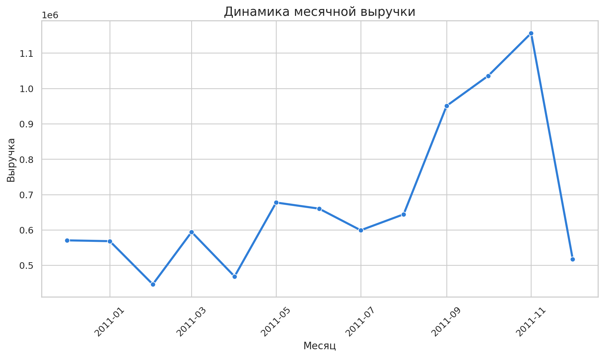
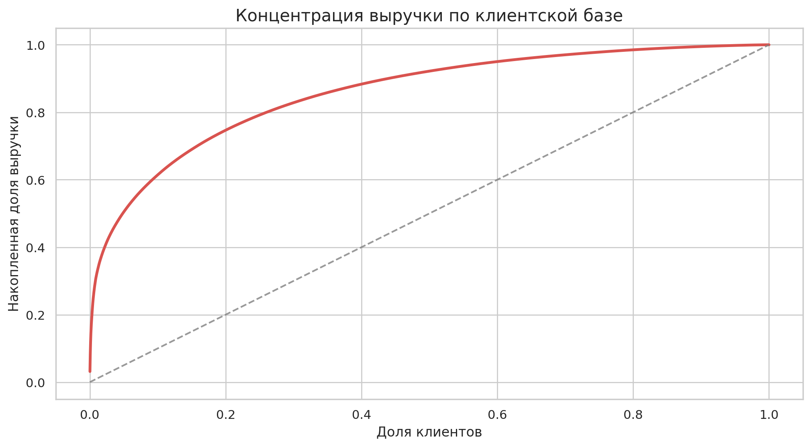
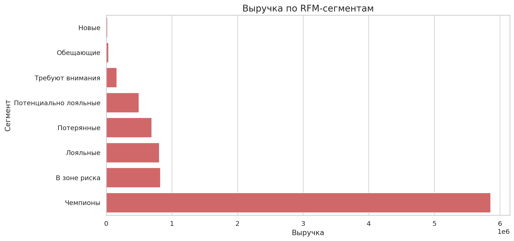
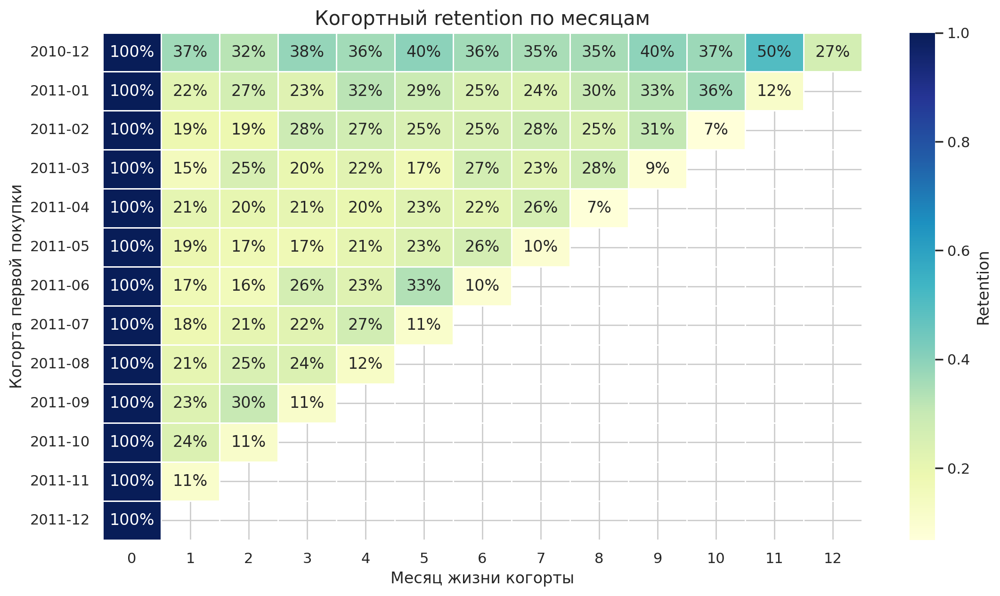
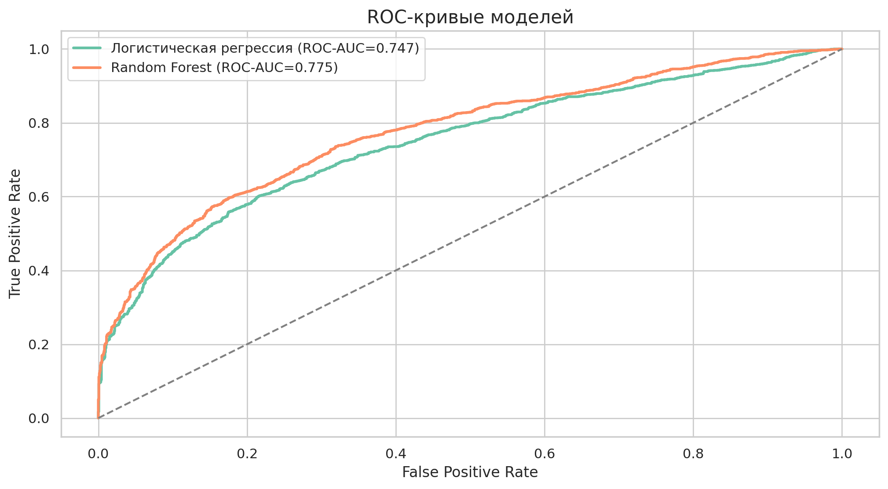
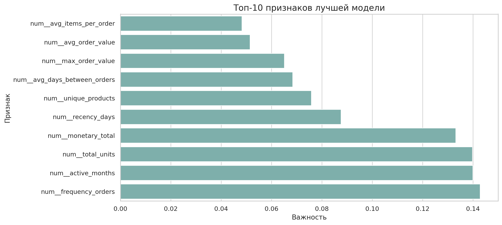

# Анализ повторных покупок и сегментация клиентов интернет-магазина

## О проекте

Проект посвящён анализу транзакционных данных онлайн-ритейлера. Разбираю полный аналитический цикл: от очистки сырых данных до построения baseline ML-модели, которая прогнозирует вероятность повторной покупки.

Что охвачено:

- очистка "грязных" табличных данных;
- расчёт бизнес-метрик и исследовательский анализ;
- RFM-сегментация клиентов;
- когортный анализ и retention;
- ML-модель прогноза повторной покупки;
- бизнес-рекомендации.

## Данные

Источник: [UCI Online Retail](https://archive.ics.uci.edu/dataset/352/online-retail)

История транзакций британского онлайн-ритейлера за период с **01.12.2010** по **09.12.2011**.

Ключевые поля:

- `InvoiceNo` — номер транзакции;
- `StockCode` — идентификатор товара;
- `Description` — название товара;
- `Quantity` — количество единиц в строке заказа;
- `InvoiceDate` — дата и время покупки;
- `UnitPrice` — цена за единицу;
- `CustomerID` — идентификатор клиента;
- `Country` — страна клиента.

## Стек

- Python
- pandas, NumPy
- matplotlib, seaborn
- scikit-learn
- Jupyter Notebook

## Этапы работы

1. Первичный осмотр структуры и качества данных.
2. Очистка: удаление строк без `CustomerID`, отмен, аномальных значений и дубликатов.
3. EDA: выручка, клиентская активность, география, концентрация спроса.
4. RFM-сегментация клиентов.
5. Когортный анализ и расчёт retention.
6. Подготовка ML-выборки по временным срезам и обучение двух моделей.
7. Формулировка бизнес-рекомендаций.

## Результаты анализа

После очистки в выборке:

- **392 692** транзакционные строки;
- **4 338** клиентов;
- **18 532** заказа;
- **8 887 208.89** суммарной выручки.

Ключевые наблюдения:

- 10% клиентов формируют **61.4%** выручки, 20% клиентов — **74.7%**.
- Пик выручки — **ноябрь 2011**.
- Основной рынок — **United Kingdom**.
- Медианный чек заметно ниже среднего: есть хвост крупных заказов.





## RFM-сегментация

Три измерения:

- `Recency` — давность последней покупки;
- `Frequency` — число заказов;
- `Monetary` — суммарная выручка по клиенту.

Ключевые сегменты:

- **Чемпионы** — 25.8% клиентской базы и **65.9%** выручки;
- **Лояльные** — 7.6% клиентов и **9.1%** выручки;
- **В зоне риска** — 15.2% клиентов и **9.3%** выручки;
- **Потерянные** — 29.1% клиентов и **7.8%** выручки.

`Чемпионы` и `Лояльные` — приоритет удержания. `В зоне риска` — основной слой для реактивационных кампаний.



## Когортный анализ

Когорты построены по месяцу первой покупки.

- Средний retention первого месяца — около **20.6%**;
- Лучшая когорта по retention первого месяца — **2010-12**: около **36.6%**;
- Последние когорты интерпретируются аккуратно, потому что у них меньше времени наблюдения.



## ML-модель прогноза повторной покупки

Задача: по истории клиента на дату среза предсказать, совершит ли он хотя бы одну покупку в следующие **90 дней**.

Чтобы не было утечки — признаки считаются только по прошлой истории, а тест строится на самом позднем временном срезе.

Сравнивал две модели:

| Модель | ROC-AUC | F1 | Precision | Recall |
| --- | ---: | ---: | ---: | ---: |
| Random Forest | **0.7746** | **0.6978** | 0.7821 | **0.6298** |
| Логистическая регрессия | 0.7472 | 0.6708 | **0.7845** | 0.5858 |

Наиболее важные признаки у Random Forest:

- число заказов;
- число активных месяцев;
- суммарное число купленных единиц;
- общая денежная ценность клиента;
- recency.





## Бизнес-выводы

1. Клиентская база неоднородна: основная выручка сосредоточена у ограниченного числа покупателей.
2. Для `Чемпионов` и `Лояльных` — упор на удержание, персональные подборки, повышение LTV.
3. Для `В зоне риска` — реактивационные сценарии по recency и снижению частоты заказов.
4. Для новых клиентов важен качественный onboarding: когортный анализ показывает, что первые месяцы сильно влияют на дальнейший retention.
5. Прогноз повторной покупки можно использовать как дополнительный приоритет в CRM.

## Структура репозитория

```
.
├── data/
│   ├── raw/
│   └── processed/
├── images/
├── notebooks/
├── src/
│   ├── retail_repeat_analysis/
│   ├── build_assets.py
│   └── build_notebook.py
├── .gitignore
├── README.md
└── requirements.txt
```

## Как запустить

1. Создать и активировать виртуальное окружение.
2. Установить зависимости:

```bash
pip install -r requirements.txt
```

3. Пересобрать артефакты анализа:

```bash
python src/build_assets.py
python src/build_notebook.py
```

4. При необходимости повторно выполнить ноутбук:

```bash
python -m jupyter nbconvert --to notebook --execute --inplace notebooks/online_retail_repeat_purchase_analysis.ipynb
```

Исходный CSV не включён в репозиторий из-за размера (43 МБ). Скачать можно на [странице датасета UCI](https://archive.ics.uci.edu/dataset/352/online-retail) и положить по пути `data/raw/online_retail.csv`.
