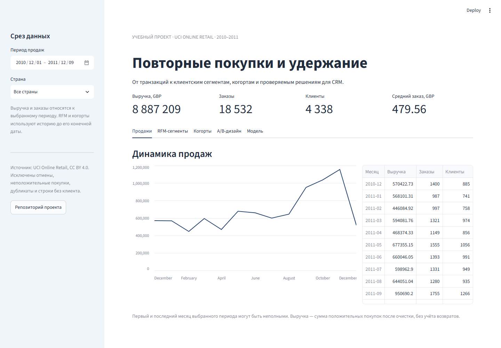

# Online Retail: аналитика удержания, дашборд и скоринг

[](https://github.com/Shishani7/online-retail-repeat-purchase-analysis/actions/workflows/ci.yml)

Учебный проект на реальных транзакциях: очистка и анализ клиентов, интерактивный **Streamlit-дашборд**, дизайн **A/B-теста** и **FastAPI-сервис** с сохранённой моделью. Есть Docker Compose и автоматические проверки API, временных границ и интерфейса.

**Навигация:** [Запуск](#запуск) · [Дашборд](#дашборд) · [API](#api-прогноза) · [Модель](#модель-и-временная-проверка) · [A/B-дизайн](docs/AB_TEST_DESIGN.md) · [Model card](docs/MODEL_CARD.md) · [Демонстрация](docs/DEMO.md)

## Что реализовано

| Часть | Проверяемый результат |
| --- | --- |
| Аналитика | Очистка, таблица заказов, RFM-сегментация и когортный retention |
| Streamlit | Период и страна, KPI, графики, сегменты с экспортом CSV, тепловая карта retention |
| A/B-тест | Дизайн CRM-эксперимента, исторический baseline, выборка и отдельно помеченная синтетическая симуляция |
| ML | Признаки до среза, выбор модели по валидации, обучение на созревших 90-дневных ответах |
| FastAPI | POST /predict, валидация признаков, /health, /metadata и /docs |
| Docker и CI | Запуск двух сервисов одной командой; автоматические тесты и HTTP-проверка контейнеров |

## Запуск

### Docker: данные и модель уже в репозитории

Нужен работающий Docker с Compose. Для демонстрации скачивать сырой датасет или обучать модель не требуется.

```bash
git clone https://github.com/Shishani7/online-retail-repeat-purchase-analysis.git
cd online-retail-repeat-purchase-analysis
docker compose up --build -d --wait
```

- Дашборд: [localhost:8501](http://localhost:8501).
- Документация API: [localhost:8000/docs](http://localhost:8000/docs).
- Проверка сервисов: `python scripts/smoke_services.py`.
- Остановка: `docker compose down`.

Порты опубликованы только на localhost. Проект не развёрнут на отдельном публичном сервере; локальная демонстрация не требует облачных аккаунтов.

### Python: разработка и тесты

Python 3.11 или 3.12 и [uv](https://docs.astral.sh/uv/). Для совпадения с опубликованной моделью предпочтителен Python 3.12.

```bash
uv sync --frozen --extra dev
uv run streamlit run app.py
```

Во втором терминале:

```bash
uv run uvicorn retail_repeat_analysis.api:app --host 127.0.0.1 --port 8000
```

`uv.lock` фиксирует версии. Альтернатива: `python -m pip install -r requirements.txt` (версии разрешаются по диапазонам проекта; это не эквивалент фиксированному окружению).

## Дашборд



Пять вкладок: продажи, RFM-сегменты, когорты, A/B-дизайн, модель. Загрузка таблицы заказов кэшируется с учётом изменения файла. Интерфейс использует опубликованный `data/processed/orders.csv`.

- **Период продаж** меняет выручку, заказы, клиентов и средний чек.
- **RFM** использует всю историю выбранной страны до конечной даты. Начало периода продаж не обрезает клиентскую историю.
- **Когорты** определены по первой покупке в выбранной истории. Наблюдённый месяц без возвратов показан нулём; будущий или неполный следующий месяц - пустой ячейкой. Месяц 0 задаёт базу когорты.
- **A/B-калькулятор** позволяет менять baseline и MDE. Искусственные исходы явно отделены от данных магазина.
- **Метрики модели** относятся к фиксированному тесту, а не к фильтрам продаж. Дашборд не переобучает модель при переключении страны.

### Результаты анализа

После очистки: **392 692 строки, 4 338 клиентов, 18 532 заказа**. Сумма положительных покупок - **8 887 208,89 GBP**. Отмены и возвраты исключены; это не полная бухгалтерская нетто-выручка.

«Чемпионы»: **25,8% клиентов и 65,9% выручки**. «В зоне риска»: **15,2% клиентов и 9,3% выручки**. Эти наблюдения поддерживают гипотезы удержания и реактивации; эффект кампании экспериментом не измерялся.

## API прогноза

```bash
curl -X POST http://localhost:8000/predict \
  -H "Content-Type: application/json" \
  --data-binary @examples/predict_request.json
```

В PowerShell используйте `curl.exe` с аргументами в одной строке. [Полный запрос](examples/predict_request.json) и [фактический ответ этой версии модели](examples/predict_response.json) опубликованы.

Вход - исторические признаки: давность, число заказов, сумма и чеки, активные месяцы, товары, интервалы, стаж и страна. Средний интервал допускает null. Обязательные поля перечислены в `/docs`.

Ответ содержит `score`, `prediction`, порог, горизонт и версию модели. Неподходящий тип, отсутствие обязательного поля, отрицательное или нечисловое значение, NaN/Infinity, лишнее поле и противоречивые признаки возвращают **422**. Неизвестная текстовая страна поддерживается encoder с `handle_unknown="ignore"`.

Модель загружается один раз при старте, проверяется SHA-256 из `models/metadata.json`. Обучения на каждом запросе нет. Загружайте joblib только из доверенного источника. Авторизация, мониторинг дрейфа и нагрузочное тестирование находятся за пределами учебного прототипа.

## Модель и временная проверка

Задача: хотя бы одна покупка известного клиента за следующие **90 дней**. Модели сравниваются на общей хронологической схеме.

```text
Выбор: обучение на 01.03 -> валидация на 01.06
Финальный fit: срезы 01.03, 01.04, 01.05, 01.06 -> тест на 01.09
Для каждого fit: конец 90-дневного ответа обучения <= дата следующего прогноза
```

Модель выбрана по validation ROC-AUC. Финальный тест не участвует в выборе. Порог фиксирован: 0,5. Июльские и августовские срезы исключены из финального обучения: ответы ещё не известны на 1 сентября.

| Модель | Validation ROC-AUC | Test ROC-AUC | Test F1 | Test Precision | Test Recall |
| --- | ---: | ---: | ---: | ---: | ---: |
| Logistic Regression | 0,7510 | 0,7353 | 0,6705 | 0,7735 | 0,5917 |
| **Random Forest (выбран)** | **0,7545** | **0,7456** | **0,6983** | 0,7421 | **0,6593** |

Тест: 3 317 клиентов на 1 сентября 2011, ответы наблюдены до 30 ноября. [Полный отчёт](data/processed/temporal_validation.json), [model card](docs/MODEL_CARD.md). Прежние метрики исходного разбиения заменены пересчётом.

Ограничения: короткая история, одна валидационная и одна тестовая дата, зависимые срезы одного клиента. На новых клиентах качество не оценивалось. Скор не проходил калибровку и не является индивидуальным эффектом рассылки.

## Дизайн CRM-эксперимента

В [документе дизайна](docs/AB_TEST_DESIGN.md) зафиксированы гипотеза, аудитория, рандомизация, метрики, выборка и правила анализа.

Исторический baseline «В зоне риска» на 1 ноября: **158 покупателей из 620 клиентов**, около **25,48%** за следующие 30 дней. Для абсолютного MDE 2 п.п., α=5% и мощности 80% требуется **7 640 участников на группу**. Это планирование, не эффект воздействия. Исторической базы для такого полевого теста недостаточно.

Контрольный условный пример 20% -> 22%: 6 510 на группу. [Симуляция](data/processed/ab_simulation.json) использует искусственные данные. Фактические результаты новой CRM-кампании не заявляются.

## Проверки и воспроизведение

```bash
uv sync --frozen --extra dev --extra notebook
uv run ruff check .
uv run pytest -q
uv run python -m retail_repeat_analysis.download_data
uv run python src/build_assets.py
uv run python src/build_notebook.py
uv run jupyter nbconvert --to notebook --execute --inplace notebooks/online_retail_repeat_purchase_analysis.ipynb
```

Загрузчик получает оригинальный XLSX из UCI, проверяет схему и число строк, записывает CSV и контрольные суммы. Большой CSV не хранится в Git. Сборка пересчитывает таблицы, модели, рисунки, отчёт разбиения, запрос/ответ API и A/B-планирование.

Тесты проверяют временные границы, независимость исторических признаков от будущих транзакций, нули retention, фильтры и пустые выборки, входы API, сохранённый прогноз, выборку и виджеты Streamlit. GitHub Actions также собирает Docker-образ и проверяет HTTP-ответы двух контейнеров.

## Данные и атрибуция

Chen, D. (2015). **Online Retail**. UCI Machine Learning Repository. [DOI: 10.24432/C5BW33](https://doi.org/10.24432/C5BW33). [CC BY 4.0](https://creativecommons.org/licenses/by/4.0/). Исходные строки преобразованы и агрегированы; таблицы и изображения являются производными материалами.

Период: 1 декабря 2010 - 9 декабря 2011. Декабрь 2011 неполный; в выборке есть оптовые покупатели.

